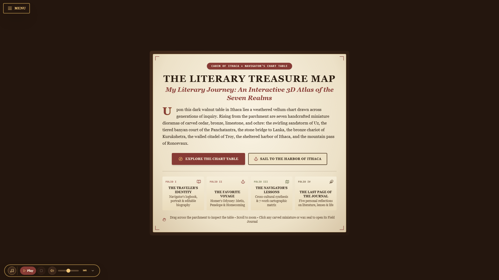

# The Literary Treasure Map: An Interactive 3D Atlas of the Seven Realms
## The Navigator's Chart Table & Academic Portfolio



An immersive 3D historical cartography experience and Great Books digital academic portfolio set in a warm, candlelit navigator's cabin in Ithaca. Seven carved miniature landscape dioramas rise from an aged parchment map resting on a dark walnut chart table, inviting interactive exploration of foundational literary works across the Ancient Near East, Ancient India, Archaic Greece, and Medieval Europe.

---

## Architecture & Key Features

### 1. The Living 3D Navigator's Chart Table (`src/three/`)
- **Walnut Table & Cabin Artifacts (`src/three/tableProps.ts`)**: Dark walnut chart table with beveled moldings, brass corner brackets, embossed leather inlay, flickering beeswax candle in a chamberstick casting directional shadows, brass dividers, ceramic inkpot with feather quill, wax-sealed parchment scrolls, and a live 3D brass pocket compass whose needle turns toward the active landmark.
- **Procedural Illuminated Parchment Map (`src/three/parchmentTexture.ts`)**: High-resolution (`2048x1320`) aged vellum chart with coastlines, sea contours, portolan rhumb lines, compass roses, hand-drawn mountain ridges, rivers, banyan forests, sea serpents (*Leviathan*), dotted voyage routes, and Latin/English cartographic marginalia.
- **Seven Distinct Carved Miniature 3D Dioramas (`src/three/monuments.ts`)**:
  - **Realm I**: *The Odyssey* (`The Harbor of Ithaca` — Centerpiece with twin rocky headlands, olive trees, winding coastal path, inlaid brass compass rose, and an Athenian trireme with oars, rigging, and weathered sail).
  - **Realm II**: *The Book of Job* (`The Whirlwind of Uz` in ochre sandstone, carved timber, and spiraling wind ribbons).
  - **Realm III**: *The Panchatantra* (`The Emerald Banyan Court` with five interlocking wooden platforms, aerial roots, canopy foliage, and carved animal figures).
  - **Realm IV**: *The Ramayana* (`The Sculpted Bridge to Lanka` with multi-arch stone causeway spanning sea waves toward fortified golden towers).
  - **Realm V**: *The Mahabharata* (`The Bronze Chariot of Kurukshetra` with 12-spoked bronze wheels, domed canopy, two sculpted horses, and battlefield standards).
  - **Realm VI**: *The Iliad* (`The Walled Citadel of Troy` with battered limestone curtain walls, Scaean Gate, watchtowers, and the bronze Shield of Achilles).
  - **Realm VII**: *The Song of Roland* (`The Pass of Roncevaux` with cloven Pyrenean crags, watchtower, ivory Oliphant horn, and Durendal sword).
- **Camera & Accessibility**: Bounded pointer-drag rotation, scroll zoom, mobile touch support, cubic-eased flights to landmarks, reduced-motion mode, and an illustrated 2D parchment fallback when WebGL is unavailable.

### 2. The Field Journal & Four Companion Folios (`src/components/`)
- **The Field Journal & Navigator's Chart (`NavigatorsChart.tsx`)**: Unfolds like a leather-bound and aged-vellum manuscript beside the selected miniature, with illuminated drop caps, scholarly marginalia, verified quotations, contemporary reflections, and charted route links.
- **Folio I (`TravelerJournalModal.tsx` - *The Traveler's Identity*)**: Academic student logbook (complete name, course, year/section, institution, portrait miniature, and three personal narrative sections) sourced from the centralized static data file ([`src/data/portfolioData.ts`](file:///src/data/portfolioData.ts)).
- **Folio II (`OdysseySpotlightModal.tsx` - *The Favorite Voyage*)**: Dedicated centerpiece folio for *The Odyssey* featuring the verified Book 20 quotation (*"Endure, my heart..."*, A. T. Murray Loeb translation), reasons for selection, key characters, three thematic entries (*Metis Over Brute Force*, *Penelope and Equal Minds*, *Nostos and Humility*), personal connection essay, and a direct button to locate Ithaca on the 3D map.
- **Folio III (`ConstellationsModal.tsx` - *The Navigator's Lessons*)**: Four cross-cultural synthesis pillars and a filterable 7-work comparative cartographer's ledger.
- **Folio IV (`ReflectionModal.tsx` - *The Last Page of the Journal*)**: Scholarly personal responses to all five core reflection questions plus a concluding colophon.

### 3. Tactile Audio & Navigation
- **Tactile Sound Engine (`src/utils/soundEngine.ts`)**: Procedural parchment page-turn rustles, wooden instrument clicks, and muted antique brass chimes synthesized via the Web Audio API.
- **Soundtrack Player (`src/components/WebsiteSoundtrackPlayer.tsx`)**: Global ambient soundtrack with volume slider and playback controls.

---

## Tech Stack

| Layer | Technology |
| --- | --- |
| **Framework** | [React 19](https://react.dev/) + [TypeScript](https://www.typescriptlang.org/) |
| **Build Tool** | [Vite 6](https://vitejs.dev/) with `@tailwindcss/vite` |
| **Styling** | [Tailwind CSS 4](https://tailwindcss.com/) with custom vellum and walnut themes |
| **3D Rendering** | [Three.js (r173)](https://threejs.org/) with custom WebGL shaders & procedural canvas textures |
| **Icons** | [Lucide React](https://lucide.dev/) |
| **Testing** | [Vitest 3](https://vitest.dev/) with JSDOM |

---

## Getting Started

### Prerequisites

- **Node.js**: v18.0.0 or higher
- **npm**: v9.0.0 or higher

### Installation

```bash
# Clone the repository
git clone https://github.com/Nyorrx/GreatBooks.git
cd GreatBooks

# Install dependencies
npm install
```

### Development Server

```bash
npm run dev
```

Opens local development server at `http://localhost:5173`.

### Automated Tests

```bash
# Run unit and UI integration test suite
npm test
```

### Production Build

```bash
# Compile TypeScript and bundle production assets
npm run build

# Preview the production build locally
npm run preview
```

The compiled static files are generated in `dist/`.

---

## Deployment

Because this project is a fully static client-side web application configured with relative base paths (`base: './'` in `vite.config.ts`), it deploys cleanly to root domains as well as repository subdirectories (such as `https://nyorrx.github.io/GreatBooks/`).

### 1. Cloudflare Pages (Direct GitHub Integration - Recommended)

1. Log in to the [Cloudflare Dashboard](https://dash.cloudflare.com) and navigate to **Workers & Pages** > **Create application** > **Pages** > **Connect to Git**.
2. Select your repository (`GreatBooks`).
3. Set the build configuration:
   - **Framework preset**: `Vite`
   - **Build command**: `npm run build`
   - **Build output directory**: `dist`
   - **Root directory**: `/` (leave default)
4. (Recommended) Under **Environment variables**, set:
   - `NODE_VERSION` = `20`
5. Click **Save and Deploy**. Cloudflare Pages will automatically build and publish your site with edge caching, SPA routing rules ([`_redirects`](./public/_redirects)), and security/asset headers ([`_headers`](./public/_headers)). Every subsequent push to `master` will deploy instantly.

### 2. GitHub Actions (Continuous Integration)

The repository includes [`.github/workflows/ci.yml`](./.github/workflows/ci.yml) which automatically runs `npm ci`, vitest unit tests (`npm test`), and the production bundle build (`npm run build`) on every push and pull request.

### 3. Vercel

1. Import the repository into [Vercel](https://vercel.com).
2. Framework Preset: **Vite**.
3. Build Command: `npm run build`.
4. Output Directory: `dist`.
5. The included [`vercel.json`](./vercel.json) automatically handles single-page route rewrites.

### 3. Netlify

1. Connect the repository in [Netlify](https://netlify.com).
2. Build command: `npm run build`.
3. Publish directory: `dist`.
4. The included [`public/_redirects`](./public/_redirects) guarantees clean routing.

---

## Environment Variables

This application is completely self-contained and runs entirely in the client browser. No backend server, secret API keys, or database credentials are required.

An optional template is provided in [`.env.example`](./.env.example):
- `VITE_PORT`: Custom port for local development (default `5173`).
- `VITE_APP_TITLE`: Application browser title.

Never commit personal `.env` or credential files to version control. The repository's [`.gitignore`](./.gitignore) excludes all `.env` and `.env.*.local` files automatically.

---

## Important Maintenance Notes

- **Preservation of the Seven Islands**: The 3D models in [`src/three/monuments.ts`](file:///src/three/monuments.ts) are hand-crafted procedural dioramas. Keep their geometric scales, anchor points, and coordinate definitions intact.
- **Audio Assets**: Audio tracks reside in [`public/audio/islands/`](file:///public/audio/islands/). The application uses [`src/data/islandAudio.ts`](file:///src/data/islandAudio.ts) with `import.meta.env.BASE_URL` to ensure paths resolve across custom domains and subdirectories.
- **Adding Reflections or Modifying Content**: Academic profile and reflection texts are centrally managed in [`src/data/portfolioData.ts`](file:///src/data/portfolioData.ts). Literary realm lore and quotations are managed in [`src/data/realms.ts`](file:///src/data/realms.ts).

---

## Project Structure

```text
├── public/                 # Static assets and audio tracks
│   └── audio/              # Soundtrack files and documentation
├── src/
│   ├── components/         # Companion Folio modals and UI overlays
│   ├── data/               # Centralized static portfolio and literary data
│   │   ├── portfolioData.ts# Source of truth for student profile & reflections
│   │   └── realms.ts       # Seven literary works, analyses, and quotations
│   ├── three/              # Three.js scene, camera, lighting, and dioramas
│   ├── types/              # TypeScript interfaces and data models
│   ├── utils/              # Sound synthesis and browser preference utilities
│   ├── __tests__/          # Vitest test suites (data, audio, layout, and UI)
│   ├── App.tsx             # Root application orchestrator
│   └── main.tsx            # React application entry point
├── .env.example            # Environment configuration template
├── .gitignore              # Git ignore rules for node_modules, dist, logs, etc.
├── index.html              # HTML shell with Google Fonts
├── package.json            # Dependencies and npm scripts
├── README.md               # Project documentation
├── SECURITY.md             # Vulnerability reporting policy
└── vite.config.ts          # Vite build and test configuration
```

---

## Attributions & Third-Party Assets

- **Soundtrack**: *Echoes of the Underworld* (The Odyssey Soundtrack) composed by Ludwig Göransson. Included for educational and academic portfolio demonstration.
- **Typography**: Google Fonts — *Cinzel*, *Cormorant Garamond*, and *Crimson Pro* (licensed under the SIL Open Font License).
- **Icons**: [Lucide Icons](https://lucide.dev/) (licensed under the ISC License).
- **3D Engine**: [Three.js](https://threejs.org/) (licensed under the MIT License).

---

## Security

Please refer to [`SECURITY.md`](./SECURITY.md) for details on our vulnerability reporting process.

---

## License

This project is licensed under the [MIT License](./LICENSE).
